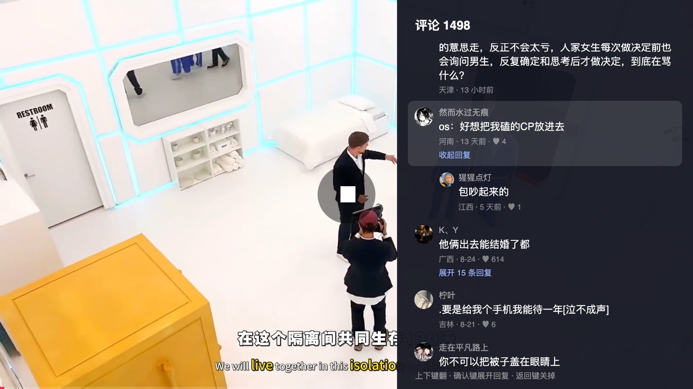
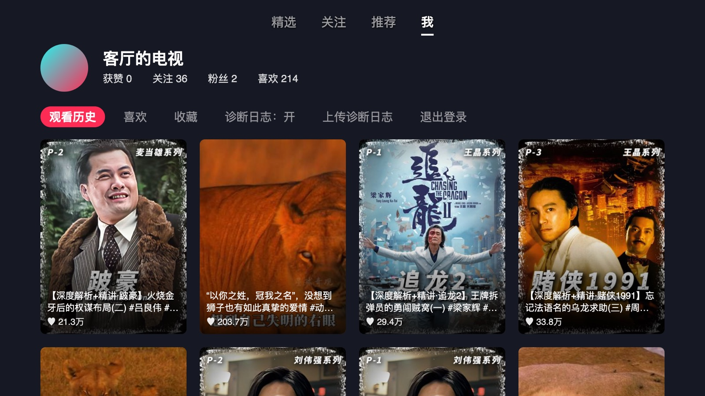

# 三星电视上刷抖音

**中文 · [English](#english)**

给三星 Tizen 电视做的抖音客户端，用遥控器刷。电视直连抖音：**没有后端，没有代理，没有服务器，
登录状态只存在电视本机。**

> **与抖音、字节跳动、三星均无关联。** 个人项目，MIT 协议。
> 兄弟项目：[bilibili-tizen](https://github.com/titlog/bilibili-tizen)、[telegram-tizen](https://github.com/titlog/telegram-tizen)。

<!-- 一行两张，八张一样大。用 HTML 表格：没有 Markdown 表格那一行空表头。 -->
<table>
<tr>
<td width="50%"><br>上下键刷。和手机上一样：作者、标题在左下，右边一列是头像 · 赞 · 评论 · 收藏 · 分享</td>
<td width="50%"><br>暂停后按下键选中右边那一列：头像 · 评论（带合集的视频还有左下的「合集」）</td>
</tr>
<tr>
<td width="50%"><br>评论侧栏：上下键翻，确认键展开回复</td>
<td width="50%"><br>作者主页：资料和作品网格，往下翻自动加载</td>
</tr>
<tr>
<td width="50%"><br>合集选集：焦点在正在看的那一集，接着放、下键下一集</td>
<td width="50%"><br>「我」：观看历史 · 喜欢 · 收藏</td>
</tr>
<tr>
<td width="50%"><br>精选：三列网格挑着看，封面是作者做的那张</td>
<td width="50%"><br>直播：上下键换直播间</td>
</tr>
</table>

> 截图是在电脑上的测试台里没登录截的（`spike/desktop-harness/readme-shots.mjs`）。「我」那一张没登录看不到，名字和列表是编的
> （拿截图里那位作者的作品和那个合集填的）。

## 能做的

- **直播 / 精选 / 关注 / 推荐 / 我** 五个标签。关注、推荐上下键刷，播完自动下一条；每个标签各记各的位置。
- **左右键**快退 / 快进 10 秒；**暂停后按上键**到顶上的标签栏，左右键切标签，下键回来。
- **精选**：三列网格挑着看，看的时候上下键接着刷，返回键回到网格。
- **直播**：上下键换直播间，进一个直播间 1 秒多出画面。
- **扫码登录**：官网的登录页在隐藏框里打开，二维码搬到电视上放大。
- **「我」**：观看历史、喜欢、收藏三排网格 —— 手机上刷到收藏了的，坐到沙发上在电视上放。
- **暂停时按下键**选中右边那一列的头像，上下键往下走、确认键进：
  - **头像 → 作者主页**：资料、作品网格，往下翻自动加载；
  - **合集**：选集，焦点在正在看的那一集，接着放，下键就是下一集；
  - **评论**：右边列出评论，能展开回复（只读）。
- 横屏竖屏都铺好，切换有上推动画；常驻的 MSE 播放管线，换一条 0.2–0.5 秒。
- 播放和观看历史照官网的方式上报，手机上也看得到。
- **自动更新**（1.2.0 起）：开着应用时查到新版本就在后台下载，下次打开生效，屏幕上提示「已更新到 x.y.z」。
- **诊断日志**（1.2.1 起）：出问题时，应用会收集一些排查必要的运行信息传给开发者，不会泄露个人隐私。「我」里可以关掉；
  报问题时附上那里显示的这台电视的编号。从源码装的版本也一样会传；不想传的话，在 `~/.bilibili-tizen.conf` 里写一行
  `DOUYIN_DIAG_TO=off`，这样装出来的构建就不传。

## 怎么做到的

抖音网页接口要 `a_bogus` 签名，而签名 SDK 只有跑在 `www.douyin.com` 的页面里才签得对。三星电视的 web widget
能对 `www.douyin.com` 的 iframe 执行脚本，所以在一个隐藏框里让官网自己的 SDK 签名 —— 「签名桥」。
来龙去脉、全部测量和踩过的坑在 [`CLAUDE.md`](CLAUDE.md)。

## 我的电视能装吗

| | |
|---|---|
| **实测可用** | 三星 2023 年款 65 吋 **CU7090**，固件 Tizen 9.0（Chromium 120） |
| **其他机型** | 没人试过。装成功或者失败，都欢迎开 issue 说一声机型和固件版本 |

## 安装

三星商店不收第三方客户端，只能侧载。**只需要一次**，之后电视上直接开。两条路：

| | 装发布包（推荐） | 从源码装 |
|---|---|---|
| 适合 | 只想在电视上刷抖音 | 要改代码、要看诊断日志 |
| 需要 | 电脑（Windows / macOS / Linux）**或安卓手机**，装上 [Apps2Samsung](https://github.com/Apps2Samsung/Apps2Samsung) | macOS、Node、Tizen Studio 命令行工具 |
| 升级 | **1.2.0 起自动更新**（见下）；1.2.0 以前的用 Apps2Samsung 再装一次 | `git pull`，再跑一次 `deploy.sh` |

**两条路都要先做这一步：** 电视上打开开发者模式——在「应用」页面用遥控器输入 `12345`，打开开关，Host PC IP 填装应用的
那台电脑或手机的 IP——然后**把电视完整断电重启一次**。

两条路都还要一个三星账号（没有就免费注册一个）：第一次安装时会让你登录，用来给这台电视申请证书，之后不用再管。

### 装发布包

1. 装 [Apps2Samsung](https://github.com/Apps2Samsung/Apps2Samsung/releases)，电脑版、安卓版都行。
2. 打开它，选中你的电视（列表里没有就手动输入电视的 IP）。
3. 在它的应用列表（社区目录）里找到 **Douyin (抖音)**，安装。第一次会让你登录三星账号，替这台电视签证书。

社区目录每天从这里同步一次最新的发布包。想装目录还没同步到的新版本，或者某个指定版本：到
[Releases](https://github.com/titlog/douyin-tizen/releases/latest) 下载 `douyin-tizen-<版本>.wgt`，第 3 步改选自定义 `.wgt`，
选这个文件。

**只有 iPhone？** Apps2Samsung 没有 iOS 版，侧载要一台电脑或者一部安卓手机。不过只需要装一次（之后新版本电视自己装），
借一台电脑装一次就够了。

### 从源码装

电视、证书、签名档都沿用 [bilibili-tizen](https://github.com/titlog/bilibili-tizen) 的配置：先按它 README 里「从源码装」
那一节跑一次 `zsh tools/setup.sh`。然后：

```bash
git clone https://github.com/titlog/douyin-tizen.git && cd douyin-tizen
zsh tools/deploy.sh          # 打包、签名、安装、启动
```

### 升级

**装着 1.2.0 及以后版本的电视会自己更新**：开着应用时查到新版本就下载，下次打开生效。要真的退出再开才算：按两次返回键退出，
再从电视主页打开。更新包用这个仓库的钥匙签名，电视下载后先验签名再用，坏了的版本会自动退回安装包里的那份。
1.2.0 以前的版本没有这个功能，要按上面的步骤再装一次。

> **两条路不要来回换。** 两边签名用的证书不同，电视不让一个证书签的包覆盖另一个证书签的同名应用。要换路，先在电视上把
> 旧的删掉再装——删掉会清空扫码登录，要重新扫一次。

## 调试

零售机上看不到日志，应用自己往电脑上报：

```bash
node tools/collect.mjs       # 终端 1：在 8098 端口收日志
zsh tools/deploy.sh          # 终端 2
zsh tools/deploy.sh --selftest   # 在电视上无人值守地走一遍：刷、暂停、切标签、作者主页……
```

自测构建会自己换视频、暂停，看之前记得再跑一次普通的 `deploy.sh`。

## 目录

```
app/          客户端（ES5，没有构建步骤）
  js/bridge.js   签名桥：隐藏框里的官网 SDK
  js/feed.js     推荐 / 精选 / 关注的视频流
  js/mse.js      常驻的 MSE 播放管线
  js/vendor/     mp4box.js
spike/        当初摸清平台的探测工装和桌面测试台
tools/        部署、发布包（release.sh）、日志收集、lint、自动更新（update-*.mjs）
CLAUDE.md     全部发现、坑，以及怎么在零售机上调试
```

## 协议

MIT。`app/js/vendor/mp4box.js` 是 BSD-3-Clause，见 [`mp4box.LICENSE`](app/js/vendor/mp4box.LICENSE)。
抖音是其所有者的商标，本项目与之无关联。

---

## English

A Douyin (TikTok China) client for Samsung Tizen TVs, driven by the remote. The TV talks to Douyin directly —
no backend, no proxy, no server; the login stays on the set.

- Five tabs (live / featured / following / recommended / me). Following and recommended: up and down to browse, autoplay next.
- Left and right skip back / forward 10 s. To change tabs, pause and press up to reach the tab bar, then left / right; down to return.
- Featured is a three-column grid to pick from; while watching, up and down keep browsing, Back returns to the grid.
- Live: up and down to change rooms; a room shows picture in a little over a second.
- QR sign-in: the official login page runs in a hidden frame and its QR code is shown full size on the TV.
- "Me": your watch history, likes and favourites as grids — save it on the phone, watch it on the TV.
- Pause and press down to pick the uploader (profile and videos), the series (episode list, continues from the
  current episode) or the comments (read-only side panel with replies).
- A resident MSE pipeline: switching videos takes 0.2–0.5 s.
- Self-update from 1.2.0: a newer signed version is downloaded in the background and runs from the next launch.
- Diagnostic logs from 1.2.1: when something goes wrong, the app sends the developer the information needed to find out why,
  and nothing that identifies you. It can be switched off under 我 ("me"); when reporting a problem, quote the TV's code shown there.

Douyin's web API wants an `a_bogus` signature that only the site's own SDK, running on `www.douyin.com`, produces
correctly. A Tizen web widget can script a `www.douyin.com` iframe, so the official SDK signs requests in a hidden
frame. The details, measurements and pitfalls are in [`CLAUDE.md`](CLAUDE.md) (Chinese).

Tested on a 2023 Samsung CU7090 (Tizen 9.0). The easy way to install: enable Developer Mode on the TV and power-cycle it,
then open [Apps2Samsung](https://github.com/Apps2Samsung/Apps2Samsung) (desktop or Android), select the TV and install
**Douyin (抖音)** from its app list (the community catalog); the first install asks you to sign in to a Samsung account
(free to create) to get the TV a certificate. The catalog picks up the latest release from here once a day; for a
version it has not picked up yet, download `douyin-tizen-<version>.wgt` from
[Releases](https://github.com/titlog/douyin-tizen/releases/latest) and install it as a custom `.wgt`. Only an iPhone?
Apps2Samsung has no iOS version, but it is needed once, so borrowing a computer for the install is enough. From 1.2.0 the app
updates itself (the new version runs after you quit and reopen it); older versions: install again with Apps2Samsung. From
source: set up the TV and the Samsung certificate with [bilibili-tizen](https://github.com/titlog/bilibili-tizen)'s
`tools/setup.sh`, then run `zsh tools/deploy.sh` here.

MIT. mp4box.js is BSD-3-Clause. Not affiliated with Douyin, ByteDance or Samsung.
